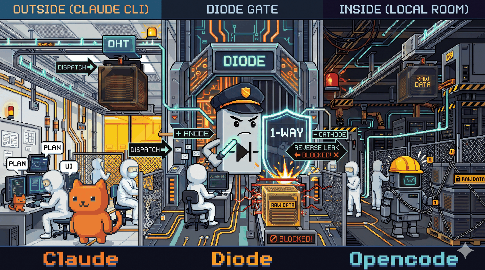

> **개발 중 (v0.0) — 아직 synthetic data로만 테스트했어요. 사내 자체 검증을 마치기 전에는 real data에 사용하지 마세요.**<br>
> 'Diode'라는 이름은 비유일 뿐, 물리적인 hardware data diode가 아닙니다. one-way gateway와 같은 수준의 보증을 주지 않아요.

# Diode

<h3 align="center">한쪽으로만 흐르게.</h3>

<p align="center">

<br>
<sub>outside (Claude CLI) · junction (Diode) · inside (in-house LLM) — instruction은 안으로 흐르고, raw data는 밖으로 나가지 못해요.<br>
그림 속 Claude · Opencode는 이해를 돕기 위한 표현이며, 각 제품의 공식 이미지가 아닙니다.</sub>
</p>

<p align="center"><sub>
CLAUDE CODE PLUGIN · REPO 하나 = PLUGIN 하나 = MARKETPLACE 하나<br>
Python 3.8+ · standard library only<br>
테스트 1233 · WINDOWS + UBUNTU CI
</sub></p>

## Diode는 무엇인가요?

Diode는 Claude Code에 설치하는 plugin이에요. skill 하나와 hook, MCP hub, confirm window가 한 묶음으로 들어 있습니다.

회사의 raw data는 Claude에게 넘어가면 안 되죠. 그렇다고 기획과 화면 설계까지 in-house LLM에만 맡기면 Claude의 장점을 살리기 어렵습니다. 그래서 Diode는 일을 둘로 나눴어요. Claude는 앞에서 기획하고 instruction을 내리고, raw data를 다루는 일은 in-house LLM(opencode)이 맡습니다. Diode는 그 둘 사이에 놓여 무엇이 어느 쪽으로 흐를 수 있는지를 통제해요.

한 번 설치해 두면 매번 따로 부를 필요가 없어요. plugin은 user scope로 설치되어 이 PC의 모든 Claude Code session에서 기본으로 켜지고, hook이 session 시작·모든 prompt·모든 tool call을 먼저 거칩니다. slash command(`/diode:setup` · `/diode:status` · `/diode:speak` 등)는 설정이나 확인처럼 사람이 직접 할 일이 있을 때만 쓰면 돼요. 다만 처음 설정(`/diode:setup`)을 마치기 전이나 plugin을 꺼두면 보호가 작동하지 않으니 주의해 주세요 — 자세한 내용은 [Manual](docs/MANUAL.md#매번-부르지-않아도-됩니다--설치하면-늘-거칩니다)에서 확인할 수 있어요.

## PN junction diode처럼 작동해요

PN junction diode는 current를 한쪽으로만 흘립니다. forward bias에서 threshold voltage를 넘기면 current가 흐르고, reverse bias에서는 아주 작은 leakage current만 흐르죠. Diode도 정보에 대해 똑같은 일을 해요.

```text
   anode (p)                 junction · depletion layer                cathode (n)
   outside: Claude CLI  ─────────────▶|─────────────  inside: in-house LLM · raw data
                        clean room · hub · checker · confirm window

   forward (out → in): Claude의 instruction이 들어갑니다
   reverse (in → out): raw data는 막히고, 설계로 정한 작은 leakage만 흐릅니다
```

| PN junction diode | Diode |
|---|---|
| majority carrier (n-region) | raw data — 안쪽에는 넘쳐나지만 바깥으로 넘어가면 안 되는 데이터 |
| depletion layer | clean room과 hub — raw data가 하나도 없는 완충 영역 |
| built-in potential barrier | deterministic checker D1–D8과 closed format (brief) |
| threshold voltage | human confirmation — confirm window에서 사람이 직접 눌러야 넘어가는 문턱 |
| reverse saturation current (leakage) | sealed report — 사람이 확인하고 보낸 짧은 보고 |

- **forward는 열려 있어요.** Claude가 `dispatch`로 넘긴 instruction은 사람이 confirm window에서 한 번 확인한 뒤 in-house LLM으로 들어갑니다. Claude에게 돌아오는 것은 `{"sent": true, "job": "J-0001"}` 한 줄뿐이고, in-house LLM의 response나 log는 이 길로 되돌아오지 않아요.
- **reverse는 막혀 있어요.** raw data folder에서 연 session, in-house term이 들어간 prompt, raw data를 읽으려는 tool call은 hook이 모두 막습니다. hook에 문제가 생겨도 열리지 않고 그대로 닫혀요 (fail-closed).
- **threshold는 화면에 그대로 보입니다.** check를 모두 통과한 글은 `DIODE V>Vth 통과`, 하나라도 걸린 글은 `DIODE V<Vth 막힘 · D2 x2 @ask`로 표시돼요.

## Make it leak — 단, 가리고 정규화해서

실제 PN junction diode도 reverse로 아주 조금은 새어나가죠. Diode는 그 leakage를 일부러 설계해 두었어요. **Make it leak — but only by design.** reverse로 나갈 수 있는 것은 sealed report와 가린 파일 bundle뿐이고, raw data를 그대로 내보내는 길은 없습니다. 무언가를 밖으로 흘리려면 이름은 가리고(masking) 내용은 정규화해서(normalize) 일의 뼈대만 남겨야 해요.

1. **masking — 이름을 pseudonym token으로 바꿉니다.** 제품·공정·과제·고객 이름처럼 dictionary에 올린 in-house term은 `PH_K7Q2` 같은 token으로 바뀌어요. 자문 하나(report)는 token을 새로 뽑고, 진짜 이름과 짝지은 pseudonym table은 memory에만 둡니다. 파일 bundle은 달라요. 작업 묶음(project)이 열려 있는 동안은 같은 값이 늘 같은 token이고, pseudonym table은 vault에 암호화해서 둡니다. Claude의 답이 돌아오면 아는 token만 안쪽에서 원래 이름으로 되돌려요. 사람이 사내 용어로 Claude에게 물어볼 때는 `/diode:speak` window가 같은 역할을 합니다.
2. **normalize — 내용을 정해진 모양으로 바꿉니다.** in-house LLM은 결과를 closed format의 brief로 다시 써요. free text는 일반적인 말로만 적고, 숫자·path·address·source code·log를 적을 field는 처음부터 없습니다. 표가 꼭 필요하면 `diode.py derive`가 값을 bucket (0–4)·rank (0–9)·category token으로 아주 거칠게 줄인 derived sample만 만들어요. (이 기능은 기본으로 꺼져 있습니다.)
3. **검사합니다.** deterministic checker D1–D6이 format, dictionary term과 그 variant, path·address pattern, 숫자, code block, token을 훑어보고, D7에서 in-house LLM이 한 번 더 판정해요. 하나라도 걸리면 밖으로 내보내지 않습니다.
4. **사람이 확정해요.** confirm window (D8)에 보낼 byte가 그대로 보이고, 사람이 직접 눌러야만 나갑니다. 밖으로 흘려보낸 내용은 모두 audit log에 기록돼요.

파일을 통째로 보낼 때는 뼈대만 남길 수 없으니, normalize 대신 가린 뒤에 남은 것을 검사해요. 이 길을 masked round trip(갔다가 결과를 받아 되돌리는 한 바퀴)이라고 부릅니다. 사람이 project를 열어 두면, opencode가 보낼 파일에서 가릴 곳을 `⟦…⟧`로 표시해요. Diode는 그 자리에 project의 vault에서 pseudonym token을 붙입니다(같은 값은 같은 token). vault는 Windows DPAPI로 암호화해요. 가린 파일은 residual check R1–R6이 남은 dictionary term·path·숫자·token을 훑어보고, D7이 한 번 더 판정합니다. confirm window에서는 파일마다 열어 봐야 보내기가 켜지고, 통과한 bundle은 room의 `outbox`에 놓여요. Claude가 token으로 일한 결과를 `dispatch`로 돌려보내면, Diode가 vault로 진짜 값을 되돌려 opencode의 `restored/`에 둡니다.

Claude가 가린 값을 맞히면(U2) 그 project를 멈추고, Claude에게는 사람이 거절했을 때와 같은 답만 보내요. 맞혔다는 신호를 주지 않기 위해서입니다. 따라 하는 순서는 [Manual](docs/MANUAL.md#파일을-가려서-claude-에게-보내기--작업-묶음-9판)에 있어요.

이름을 가려도 문맥상 뜻이 남을 수는 있어요. brief가 너무 구체적이면 Claude가 가린 이름을 유추할 수 있고(tunneling), 여러 번 보낸 내용을 모으면 원래 그림이 드러날 수 있습니다(mosaic). 그래서 Claude의 답에 보낸 적 없는 dictionary term이 나오면 그 주제를 바로 멈추고, derived sample은 re-identification simulation으로 정한 limit 안에서만 만들어요. 물론 그렇다고 해서 re-identification이 100% 불가능하다고 증명할 수는 없습니다. 같은 PC에서 shell을 쥔 쪽 앞에서는 어떤 장치도 완벽한 벽이 아니라는 점 역시 마찬가지예요. 파일 bundle에서는 opencode가 표시를 빠뜨린 새 이름과 코드의 구조도 가려지지 않습니다.

## 더 읽을 것

<table align="center">
<tr><td width="620"><a href="INSTALL.md">Install</a> <sub>· Claude Code가 그대로 따라 할 수 있는 단계별 안내</sub></td><td align="right" width="40">›</td></tr>
<tr><td><a href="docs/BLUEPRINT.md">Blueprint</a> <sub>· PN junction으로 읽는 design · datasheet</sub></td><td align="right">›</td></tr>
<tr><td><a href="docs/PLAN.md">Plan</a> <sub>· design rationale · invariant · leak path</sub></td><td align="right">›</td></tr>
<tr><td><a href="docs/SPEC.md">Spec</a> <sub>· field · verdict · output format · error code</sub></td><td align="right">›</td></tr>
<tr><td><a href="docs/MANUAL.md">Manual</a> <sub>· command · known limitation</sub></td><td align="right">›</td></tr>
<tr><td><a href="RULES.md">Rules</a> <sub>· 이 repo가 지키는 12 articles</sub></td><td align="right">›</td></tr>
</table>

<p align="center"><sub>
Diode · MIT License<br>
UI 문법은 소형 hardware instrument (Teenage Engineering 류)에서 영감을 받았으며, 해당 회사와는 관련이 없습니다.
</sub></p>
